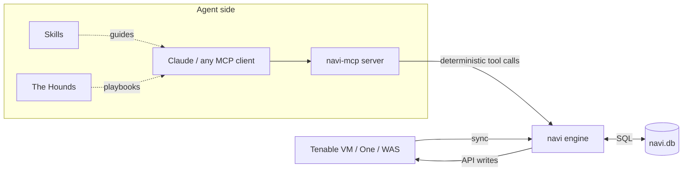

<h1 align="center">navi</h1>
<p align="center"><b>A Deterministic Agentic Engine and CLI for Exposure Management.</b></p>
<p align="center">
Built on Tenable. Grounded in your data. Reproducible by design.
</p>

<p align="center">
<a href="https://github.com/packetchaos/navi/wiki">Wiki</a> ·
<a href="https://deepwiki.com/packetchaos/navi">DeepWiki</a> ·
<a href="PUSH.md">Remote Execution</a> ·
<a href="RESEND_SETUP.md">Email Setup</a>
</p>

<p align="center">
<a href="https://deepwiki.com/packetchaos/navi"></a>
</p>

---

navi turns your Tenable exposure data into something an AI agent — or an engineer at a
terminal — can act on with confidence. It syncs Tenable Vulnerability Management, Tenable One,
and Tenable WAS into a local, queryable database, exposes every capability as a real tool, and
ships a pack of expert agents (**the Hounds**) that hunt specific classes of exposure. No
dashboards to click through, no data left on the table, and — crucially — nothing made up.

## Why "deterministic agentic"?

Most AI agents guess. They summarize, approximate, and occasionally invent an asset or a CVE
that was never there. That's fine for a chat. It is unacceptable for security work, where a
wrong answer means an unpatched host or a bad decision made with confidence.

navi is a **Deterministic Agentic Engine**: every answer an agent gives and every action it
takes is a real, reproducible tool call — against a local mirror of *your* Tenable data
(`navi.db`) or the Tenable API directly. Ask the same question twice and you get the same
answer. There is no hallucinated finding, no fabricated asset, no fuzzy summary standing in for
ground truth.

The intelligence lives in the **orchestration** — deciding what to hunt, how to tag, when to
scan, what to remediate. The **facts** always come from your data. That separation is the whole
point: agentic flexibility on top of deterministic truth.

## How it fits together



navi is four things that reinforce each other:

- **The engine (CLI).** `navi` pulls Tenable data into `navi.db`, a local SQLite mirror you can
  query in milliseconds, and turns tagging, ACR calibration, scanning, exporting, and
  remediation into single commands. This is the deterministic core everything else drives.
- **The MCP server.** `navi-mcp` exposes the engine to any MCP-capable AI (Claude and others)
  as typed tools, behind a write-gate so read operations are always safe and state-changing
  actions require an explicit opt-in.
- **The Skills.** Packaged best-practice playbooks that teach an agent *how to drive navi
  well* — the right selectors, the safe patterns, the gotchas — so the model orchestrates
  instead of improvises.
- **The Hounds.** A pack of exposure-management agents, each trained on one kind of hunt —
  known-exploited vulnerabilities, expiring certificates, attack paths, unsupported software,
  and more — grounded in exact navi selectors rather than generic advice.

## The Hounds

Each Hound is a focused exposure hunter with its own detection logic, tag scheme, and navi
selectors. Run one by name, or **release the whole pack**.

| Hound | Hunts for |
|-------|-----------|
| **Laelaps** | CISA KEV — known-exploited vulnerabilities |
| **Certania** | Certificates — expiry, weak crypto, trust issues |
| **Heimdall** | Post-quantum readiness |
| **Fenrir** | Attack paths |
| **Cerberus** | IoT / OT exposure |
| **Pythia** | AI / ML inventory |
| **Atlas** | Asset ownership and accountability |
| **Mimir** | Software inventory |
| **Charon** | End-of-life / unsupported software |
| **Anubis** | ACR calibration |
| **Chronos** | Scan health and coverage |
| **Sirius** | Agent groups |
| **Garmr** | Stale tag cleanup |
| **Orthrus** | MITRE ATT&CK mapping |
| **Argus** | Custom / homegrown apps |
| **Argos** | Single-asset deep dive |
| **Sphinx** | Environment overview ("On the Scent") |
| **Covenant** | The AI Contract — guardrails for the pack |

## Quickstart (CLI)

navi needs **Python 3.9+** (3.12 recommended) and a Tenable API key pair.

```bash
# 1. Install
pip install navi-pro

# 2. Add your Tenable API keys (stored locally, never echoed)
navi config keys --a <ACCESS_KEY> --s <SECRET_KEY>

# 3. First sync — pulls your Tenable data into navi.db.
#    This is long-running on large tenants; run it on the CLI, not through MCP.
navi config update full
```

Then start exploring and acting:

```bash
# See what navi sees
navi explore info assets
navi explore data query "select ip_address, fqdn from assets limit 10;"

# Tag every asset with a CISA KEV finding
navi enrich tag --cisa

# Export risk by business segment (includes ACR + AES)
navi export bytag

# Calibrate criticality for your crown jewels
navi enrich acr --tag "Tier:Production" --mod set --acr 9 --reason business
```

Prefer containers? A `Dockerfile` for the full **navi + navi-mcp** image lives under
[`navi-mcp-suite/`](navi-mcp-suite/) — Ubuntu 24.04, Python 3.12, isolated venv, `navi.db` on a
mounted volume.

## Quickstart (MCP server)

Give any MCP-capable AI safe, deterministic access to navi:

```bash
# Build the image (from the repo root)
docker build -f navi-mcp-suite/Dockerfile -t navi-mcp:latest .

# Store keys + do the first sync into a persistent volume
docker run --rm -v navi-data:/data navi-mcp:latest navi config keys --a <ACCESS> --s <SECRET>
docker run --rm -v navi-data:/data navi-mcp:latest navi config update full

# Serve over HTTP on :8000
docker run -d -p 8000:8000 -v navi-data:/data navi-mcp:latest
```

### Environment variables

**Core runtime** — where the server finds navi and its data:

| Variable | Purpose |
|----------|---------|
| `NAVI_WORKDIR` | Where `navi.db` and CSV exports live (mount a volume). |
| `NAVI_BIN` | Absolute path to the `navi` binary. |
| `NAVI_SKILL_DIR` | Unpacked skills, so `navi://skill/...` resources resolve. |

**Capability gates** — every one defaults to *off*; set to `1` to unlock the tools it guards:

| Variable | Unlocks |
|----------|---------|
| `NAVI_MCP_ALLOW_WRITES` | State-changing tools at all (tagging, ACR, scan, delete). Required before any gate below has effect. |
| `NAVI_EMAIL` | Emailing reports/files (`navi_action_mail`). Second gate on top of writes. |
| `NAVI_REMOTE_CODE_EXECUTION` | Remote command & file push over SSH (`navi_action_push`). Second gate on top of writes. |

**Integration keys** — for the agent and delivery layers:

| Variable | Purpose |
|----------|---------|
| `ANTHROPIC_API_KEY` | Powers the Claude-driven orchestration layer that runs the Hounds and natural-language workflows. |
| `RESEND_API_KEY` | [Resend](https://resend.com) key for emailing reports without an SMTP server (see [RESEND_SETUP.md](RESEND_SETUP.md)). |
| `HOUNDS_FROM` | Verified sender address for emailed reports. |

> Tenable API keys are **not** environment variables — set them once into the mounted volume
> with `navi config keys --a <ACCESS> --s <SECRET>` so they live in `navi.db`, never in the
> process environment or an image layer.

### The write-gate

Reads are always safe. Anything that changes state is **double-guarded**: the server must be
started with `NAVI_MCP_ALLOW_WRITES=1`, *and* each write call must pass `confirm=True`. The two
most sensitive actions raise the bar further — emailing (`NAVI_EMAIL=1`) and remote command
execution (`NAVI_REMOTE_CODE_EXECUTION=1`) each need their own dedicated flag on top of the
write-gate. An agent can look all day; it can only *act* when you've explicitly let it.

## Skills

Skills are the connective tissue between an AI and the engine — they encode the correct way to
use each part of navi so the model orchestrates expert workflows instead of guessing at flags.

| Skill | Covers |
|-------|--------|
| `navi` | Router + natural-language index into everything below |
| `navi-core` | Install, API keys, sync, `navi.db` schema, scale tuning |
| `navi-mcp` | Conventions for driving navi through the MCP tools |
| `navi-explore` | Querying and searching your data |
| `navi-enrich` | Asset tagging (plugin, CVE, CPE, KEV, SQL, and more) |
| `navi-acr` | Asset Criticality Rating calibration for Tenable One |
| `navi-export` | CSV exports, including risk-by-tag with ACR + AES |
| `navi-scan` | Create, launch, stop, and evaluate scans |
| `navi-was` | Web Application Scanning (DAST) |
| `navi-action` | Delete, rotate keys, encrypt, cancel exports |
| `navi-mail` / `navi-remote-exec` | Emailing reports and remediation push (double-gated) |
| `navi-troubleshooting` | Fixing sync errors, DB locks, empty results |
| `the-hounds` | The playbook for the whole pack |

## What navi works with

Tenable Vulnerability Management (Tenable.io), Tenable One / Exposure Management, and Tenable WAS.
navi is battle-tested at scale — it has ingested tenants with **1.5M+ assets and 160M+
vulnerabilities** into `navi.db`, with plugin queries returning in seconds. FedRAMP tenants are
supported via URL configuration.

## Documentation

- **[Wiki](https://github.com/packetchaos/navi/wiki)** — full command reference and guides
- **[DeepWiki](https://deepwiki.com/packetchaos/navi)** — ask questions about the codebase
- **[PUSH.md](PUSH.md)** — remote command & file execution over SSH
- **[RESEND_SETUP.md](RESEND_SETUP.md)** — one-time email setup

Troubleshooting (Docker memory, DB locks, key checks, scale tuning) now lives in the
[Wiki](https://github.com/packetchaos/navi/wiki) so this page stays focused.

## License

navi is released under the **MIT License**. See [LICENSE](LICENSE).
